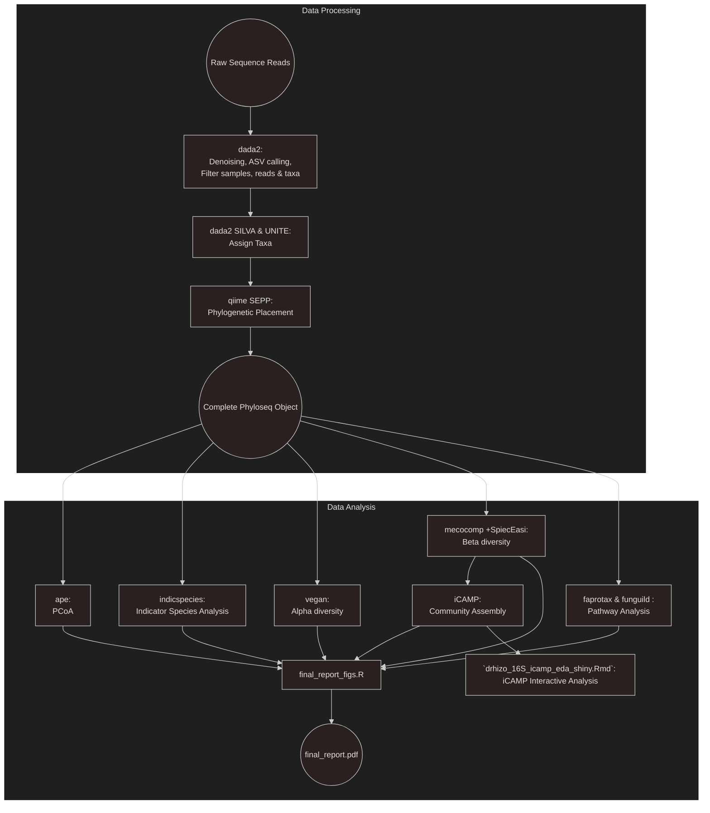

# Desert Rhizosphere Microbiome

This repo contains several analyses completed for the Pietrasiask Lab pertaining to the rhizosphere microbiome of several shrub species in the mojave desert.

The repo is split into two main components -- `Data Processing` and `Data Analysis`. Whereas Data Processing comprises the transformation from raw reads into abundances, taxonomy assignment, and phylogenetic placement, Data Analysis comprises all the downstream analyses of these data products. 

## Pipeline Overview

## Misc Scripts

The `asv_2_otu.R` script clusters ASVs determined by dada2 into OTUs with 95% similarity using the TreeLine function from DECIPHER. Interestingly, the liberal cutoff applied still left about half of 16S and ITS reads in a unique bin.

The scripts `gen_newick.sh` and `add_phylogeny.R` are a pair of programs that first add the ASVs/OTUs to a phylogenetic tree using qiime's SEPP algorithm, then adding that information back into the phyloseq object. 

 
